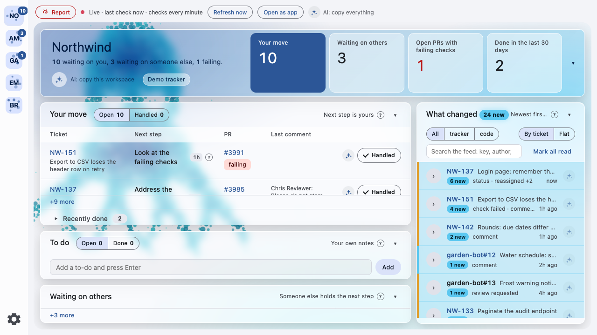

# Whose Turn

A local monitor that answers "what is waiting on me right now" across the places your work arrives: GitHub pull requests, Jira and Linear tickets, and your own to-dos. It polls each source about once a minute, decides once, on the server, whose turn every ticket is, shows the result in a window that updates live, sends a desktop notification when something becomes your move, and hands any item to an AI assistant as Markdown with its context. Its Claude Code plugin, `whose-turn@bladeforge`, makes a session start with "N your move · M unread · K to-do" already in context.

The film, 80 seconds with sound: [docs/media/whose-turn-film.mp4](docs/media/whose-turn-film.mp4). Its first act is staged; the window in the second act shows the maintainer's real workspaces on 3 November 2026.



Everything runs on your machine: a Node 22 server on `127.0.0.1`, a window built with Vue, and no account anywhere but the sources you already use. Nothing that names an employer, an account or a team process lives in this repository; it all sits in one config file on the machine that owns it.

## Install

You need Node 22 or newer and, for GitHub, the `gh` CLI signed in.

```sh
git clone https://github.com/aquivalabs/whose-turn && cd whose-turn
npm ci && npm run build
./install.sh && ./open.sh
```

`install.sh` makes the monitor start at login and restart if it stops (a launch agent on macOS, a systemd user unit on Linux; on Windows it prints the one `schtasks` line to run). `open.sh` opens the window as its own app window, or in a browser tab with `--browser`. The window listens on port 8765; `WHOSE_TURN_PORT` changes that. A clone updates with `git pull` and a rebuild; it is never offered the in-app update.

With Claude Code, the plugin installs and starts all of this for you, with no clone and no build (see [Claude Code](#claude-code)). That install updates on your word: the server checks npm every ten minutes, tells you about a new version with a desktop notification and a chip in the status bar, and installs it and restarts on one click (`POST /api/update`) or when you say yes to Claude. While it works the chip spins ("Installing…", then "Restarting…") and the window stays usable; when the server runs the new version the chip turns into "Updated to <version> · Reload", because the open window still runs the old page until you reload it. The same click then updates the Claude plugin too (`claude plugin update whose-turn@bladeforge`, run by the monitor with those fixed arguments, only after your click or yes); once the window shows the new version, a chip says "Reload Claude skill · Copy": it copies `/reload-plugins --force`, which you paste into your open Claude session to load the update there. If `claude` cannot be found or the update fails, the chip says "Update Claude skill · Copy" instead and copies `claude plugin update whose-turn@bladeforge`; after a copy the chip is gone for that version in every window; the monitor update itself is never held back by this step. An install pinned to one version (an exact version recorded by the install, or `WHOSE_TURN_APP_VERSION` in the server's environment) is never offered an update and refuses `POST /api/update` with `PINNED`.

```sh
claude plugin marketplace add aquivalabs/BladeForge
claude plugin install whose-turn@bladeforge
```

## First run

The window opens on one card: add a source through the workspace settings (the gear at the top right of the workspace header). A source needs an account and its filters; a token typed into a secret field goes to the platform's secret store, never into the config file. Claude can set a workspace up too, through the `whose_turn_config` MCP tool. From then on the server polls, the window follows, and the Claude Code plugin reads the same server.

## Workspaces and connectors

A **workspace** is one place you work: a project, a client, a side venture. It has its own connectors, its own feed and its own to-dos; nothing is mixed between workspaces. A **connector** is the code for one source type (`connectors/github.mjs`, `connectors/jira.mjs`): it takes one connector entry of a workspace (an account and its filters) and returns normalised `tickets`, `comments`, `prs`, `activity`, `asks` and `runs`, plus `me` (your name there) and, for a ticket source, `ticket_base`. It holds no rules and knows no employer. The server stamps every row with the entry's id as `source`, merges all entries by kind and runs the rules over the merged view, so a workspace may hold two entries of one type (two repositories, two Jira sites) when each carries its own `id`.

Nothing that names an employer, an account or a team process lives in this repository. It all sits in one file on the machine that owns it:

| platform | config file |
|---|---|
| macOS | `~/Library/Application Support/whose-turn/config.json` |
| Linux | `$XDG_CONFIG_HOME/whose-turn/config.json`, default `~/.config/whose-turn/config.json` |
| Windows | `%APPDATA%\whose-turn\config.json` |

`WHOSE_TURN_DATA` overrides the whole directory, `WHOSE_TURN_CONFIG` the config file alone, `WHOSE_TURN_PORT` the port (it wins over `port` in the config file; `install.sh` and the plugin read both the same way). `WHOSE_TURN_NOTIFY=off` silences desktop notifications, for a second server you run to try something. On first run there is no file: the workspace settings (the gear at the top right of the workspace), the monitor settings (the gear at the bottom of the rail) or Claude through `/api/config` writes it, or copy `config.example.json` there and fill in:

| key | meaning |
|---|---|
| `port`, `poll_seconds`, `history_days` | the port, how often to poll (default 60), how far back the feed reaches (default 14) |
| `release` | optional object for `scripts/release-linear.mjs`: `team`, `project`, `keychain_service`, `keychain_account` replace the script's defaults (README § Developing, Releasing) |
| `stale_minutes`, `failing_polls` | health alerts: no data from any source for this many minutes (default 15), or one source failing this many polls in a row (default 3) |

The four numbers `poll_seconds`, `history_days`, `stale_minutes` and `failing_polls` are editable in the monitor settings (the gear at the bottom of the rail) and through `POST /api/config` with `{settings: {...}}`; a change applies at the next poll with no restart. A value outside the range the sheet shows, typed into the config file by hand, falls back to its default and is listed in the problems the window and `/api/summary` show. `port` is not editable there.

| key | meaning |
|---|---|
| `feedback.composer` | the user's own agent that turns a remark into an issue: `{command, args}` of a CLI that reads the prompt on stdin and prints JSON (`{title, kind, body}`, or a wrapper with a `result` string that contains it); default `claude -p --output-format json --model claude-haiku-5-5`, so Claude Code on the user's subscription; `codex exec` or anything alike works the same way |
| `feedback.*` (retired keys) | `workspace`, `team`, `project`, `token_service` and `assign` are dropped from the file the next time the workspace list is saved: reports go through the relay since RMA-280 and need no tracker setup |
| `feedback.bug_words` | extra words, in any language, that make the fallback composer (used when the agent CLI gives no usable answer) call a remark a bug; matched as stems at a word start; the English defaults bug, broken, crash, error, fail, wrong always apply |
| `notifications.desktop` | `false` turns desktop notifications off for the whole monitor, `true` (the default) leaves them on; the bell in the status bar, "Notifications on/off", flips it, and so does `POST /api/notifications` with `{desktop: false}`, which answers `{notifications}`. `WHOSE_TURN_NOTIFY=off` still wins over it. The setting is stored in the config, so it survives a restart, and a change applies at once with no restart (RMA-283) |
| `workspaces[].id`, `name` | a short id used in the API and on disk (lowercase letters, digits and hyphens, up to 40, starting with a letter or digit; a missing id becomes `ws<n>`) and the display name |
| `workspaces[].key_pattern` | regex for ticket keys in PR titles and to-dos; the default matches any Jira-style key; a pattern that does not compile is refused on save |
| `workspaces[].connectors` | an object keyed by type, or a list of `{type, id?, label?, …}` entries when one type appears twice |
| `…connectors.github.repo` | the repository whose PRs are yours, `owner/name` |
| `…github.org` | review requests and notifications are kept only from this org; defaults to the repo owner |
| `…github.me` | your GitHub login; left empty, it is asked from the API once |
| `…github.account` | which `gh` account's token to use when several are logged in |
| `…github.bots` | logins whose comments never count as a human reply |
| `…github.workflow_runs` | `false` stops watching the Actions runs on the default branch; on by default |
| `…connectors.jira.base` | your Jira Cloud site, `https://` only |
| `…jira.email` | the account the API token belongs to |
| `…jira.token_service` | the secret-store entry holding the token, default `whose-turn-jira` |
| `…jira.jql` | which tickets to watch |
| `workspaces[].hidden` | `parked` or `paused`, or left out for a workspace shown in the rail. Either way the workspace leaves the rail and keeps its sources, marks, to-dos and cache. A parked workspace is polled every 15 minutes instead of every poll interval (after a restart its first check is due 15 minutes after its stored last check, at once when there is none or it is older), through the same loop and the same rate-limit backoff; when a check finds a Your move row that was not there at the previous check, the workspace is unparked in the config (the same write as `POST /api/workspaces/hidden`), comes back into the rail with a dot and a feed line (`returned`) that says so, and a desktop notification follows the usual rules. A paused workspace makes no request and never comes back by itself. Any other value is refused on save, and so is hiding every workspace. It is the "In the list" choice in the workspace settings (Visible, Park, Pause, each with a one-line explanation); Monitor settings and the "n hidden" line (its hint splits parked and paused) at the bottom of the rail list the hidden ones with a Restore button (RMA-320) |
| `workspaces[].links` | quick links shown in the header, as `"Label https://…"` strings or `{label, url}`; the repository, the Jira site and the Linear team come from the connectors by themselves, unless one of these links already points at the same site |
| `workspaces[].rules` | the team's process, see Rules below; `statuses` groups, `automation_authors` and `question_words` must be lists of strings (statuses non-empty) or the save is refused |
| `…connectors.linear.workspace`, `team`, `project` | the Linear workspace slug (the part after linear.app/), and optionally one team key or one project name; the personal API key goes to the secret store under the workspace slug |
| `workspaces[].theme.seed` | optional hex colour, `#rrggbb`; the window derives its light and dark Material 3 scheme from it (`lib/palette.mjs`); without it the stylesheet's blue stays |
| `workspaces[].theme.backdrop` | `false` turns the dot-drawn backdrop animal off for this workspace: the canvas is not rendered at all; default `true`. It is the "Backdrop animal" box under Look in the workspace settings, and `theme` may hold only this key (RMA-300) |
| `workspaces[].theme.accent` | optional second hex that sets the tertiary hue; defaults to the seed's hue turned by 80 degrees |

A flat config with `github`, `jira` and `rules` at the top level still loads as one workspace named `default`.

Secrets never go into the config. GitHub uses `gh auth token`, or `GH_TOKEN` from the environment when set. The Jira API token lives in the platform's secret store under the service and the account email: the macOS Keychain, libsecret on Linux (`secret-tool`), or the Windows Credential Manager (through `lib/platform/credential.ps1`). Paste it into the settings sheet or send it through the API, and the server stores it. When the store is missing or refuses (no `secret-tool`, a launch agent refused Keychain access), the server keeps it in `<data>/secrets/<service>@<account>` with mode 600. On macOS `security` receives the value as a command-line argument, which other local processes can see for a moment; libsecret and the Windows script read it from stdin.

State lives next to the config, per workspace: `workspaces/<id>/state.json` (last poll), `marks.json` (read, handled with its notes and automatic traces, notified), `todos.json`, `cache.json` (fetched PR details, so a restart does not refetch them; versioned, never holds a token).

## Platforms

| platform | autostart | secrets | notifications | status |
|---|---|---|---|---|
| macOS | launchd agent, `install.sh` | Keychain | `osascript` | in daily use |
| Linux | systemd user unit, `install.sh` | libsecret, else file | `notify-send` | scripts and argv tested with stubs; not run on a real machine |
| Windows | Task Scheduler, one `schtasks` line that `install.sh` prints | Credential Manager, else file | PowerShell balloon | untested on Windows |

On Windows, run `schtasks /Create /SC ONLOGON /TN whose-turn /TR "\"<path to node.exe>\" \"<this folder>\server.mjs\""` once; `install.sh` prints the same line and installs nothing. The notification is a `NotifyIcon` balloon shown by `powershell`, which Windows 10 and 11 display as a toast; title and body reach it through environment variables, not through the script text.

Restart after a self-update: launchd names its job in `XPC_SERVICE_NAME` and restarts on any exit (`KeepAlive`), so the server exits 0; the systemd unit shows in the process's cgroup and restarts only on a non-zero exit (`Restart=on-failure`), so it exits 75. Without an agent the server closes its port, starts the new copy detached and exits.

## Files

| file | role |
|---|---|
| `server.mjs` | entry: config, the poll loop with rate-limit backoff, the API |
| `lib/config.mjs` | data directory, defaults, the workspace list |
| `lib/workspace.mjs` | one workspace: polls its connectors, merges results, derives events, evaluates rules, notifies |
| `lib/rules.mjs` | the "whose turn" rules and the feed |
| `lib/palette.mjs` | a workspace's light and dark scheme from its theme seed |
| `lib/api.mjs` | the local HTTP API, SSE stream and static files |
| `lib/window.mjs` | the app window's remembered size and the launcher behind "Open as app" |
| `lib/http-client.mjs`, `lib/secrets.mjs` (with `lib/platform/credential.ps1`), `lib/notify.mjs`, `lib/store.mjs`, `lib/errors.mjs`, `lib/text.mjs` | ETag fetch, secret lookup, desktop notification, files on disk, the error envelope, text helpers |
| `connectors/` | one module per source type |
| `web/` | the window: a Vue 3 app in TypeScript built with Vite (`web/src/App.vue`, primitives in `web/src/ui/`, one folder per island in `web/src/features/` with its components, composables and tests, shared composables in `web/src/composables/` (ADR 0006), each component's styles in a scoped BEM block (layout and shared primitives in `web/src/styles/base.css`, ADR 0005), pure logic in `web/src/lib/`, the dot-drawn animal in `web/src/backdrop.ts`, Tippy.js 6.3.7 and Popper 2.11.8 pinned in `web/public/vendor/`); `npm run build` writes `dist/`, which the server serves and git ignores (ADR 0001) |
| `install.sh` | bash installer that picks by `uname`: on macOS the launch agent `local.whose-turn` (log in `~/Library/Logs/whose-turn.log`); on Linux the user unit `~/.config/systemd/user/whose-turn.service` (log in `journalctl --user -u whose-turn`); both start at login and restart on a crash; on other systems it prints the Windows `schtasks` line. The agent runs `launch.sh`, which resolves node at every start (login shell, then PATH, then the path `command -v node` found at install time, kept as `WHOSE_TURN_NODE`), so removing a version-manager Node does not break it; `WHOSE_TURN_DATA` and `WHOSE_TURN_PORT`, when set in the shell that runs it, are written into the plist or the unit and named in the "Installed" line |
| `open.sh` | opens the window as its own app window (Chrome on macOS; Chrome, Chromium or Edge on Linux) at the size it last had, or in a browser tab with `--browser` or when none of those is installed; bash, not zsh, so it runs on Linux too; Windows: open the URL yourself |
| `test/` | `node:test` suite: rules, config, ADF conversion |

## Sources and polling

**GitHub**, token from `gh auth token`, or from `GH_TOKEN` when that variable is set (CI, a machine without `gh`):

- `search/issues` finds your open PRs and PRs updated in the last `history_days`. Full details are fetched only for PRs whose `updated_at` changed: PR, reviews, issue comments, inline comments, check runs.
- Open PRs get their check runs re-polled every cycle, because CI finishing does not bump `updated_at`. Each check counts by its latest attempt: a re-run, or a run that a newer one cancelled, replaces the older one (RMA-382).
- Workflow runs: one `GET /repos/{owner}/{repo}/actions/runs?branch=<default branch>` per poll (the default branch itself is asked once a day) finds runs that fail on the default branch after a merge, on a schedule or in a `workflow_run` chain; each failure and the success that ends it reach the feed as `check failed` and `check passed`, runs of pull requests are left to the PR path, and `workflow_runs: false` on the connector turns this off.
- `search/issues` with `is:pr is:open user-review-requested:<you> org:<org>` gives the open PRs that still wait for your review, read or unread, with no dependency on GitHub's web notifications (RMA-358).
- `/notifications?participating=true&all=true&since=<history window>` gives @-mentions on PRs and issues that are not yours, read ones included, filtered to the org.
- Every GET carries an ETag; a 304 does not count against the 5000/h limit. Steady state is about 1 to 10 requests a minute per workspace.
- The token is sent only to `https://api.github.com/`.

**Linear**, GraphQL with a personal API key: two queries per poll, your open issues and your issues completed in the last 30 days, optionally one team or one project, with up to 50 comments and the state history of each; the moment an issue entered its current state comes from that history. Mentions in comments become `@Name`.

**Jira Cloud REST**, email plus API token, Basic auth:

- `POST /rest/api/3/search/jql` with the workspace's JQL. Fields: summary, status, assignee, updated, comment. All comments are kept. Comment bodies arrive as ADF and are turned into Markdown-ish text: mentions become `@Name`, media becomes `[image]`.
- `GET /rest/api/3/issue/{key}/changelog` for each open ticket tells when and by whom it entered its current status. Cached until the ticket's `updated` changes.
- Status and assignee changes between polls become feed events.

On a 403 or 429 rate limit the poll delay doubles up to 15 minutes, then returns to `poll_seconds`.

The reviewers of an open PR are the still requested (users and teams) as plain names, then those who reviewed, with their latest state. A comment-only review shows the name without a mark and never replaces an approval or a request for changes, a dismissed review takes that person's state away, and you, the author and bots are left out (RMA-315).

## Rules: whose turn

Each ticket is joined with its PR by the ticket key in the PR title; the rules keep one PR per ticket key per workspace, so a ticket with PRs in two repositories of one workspace shows one of them. A ticket in code review lists every reviewer of its PR instead of "Reviewer": those still requested as plain names (people and teams), then those who already reviewed, `✓ name` for approved and `✗ name` for changes requested, from each person's latest review (a comment-only review shows the name without a mark, a dismissed one is ignored, you are left out). The list wraps in the window and costs no extra request. The server computes a set of facts per ticket (`pr.checks`, `ticket.status`, `ticket.assignee`, `unanswered_count` and the rest, listed by `GET /api/config` under `facts`) and walks the workspace's rules table: the first row whose conditions hold decides whose turn it is and the next step. The full contract is in [docs/mechanisms/rules-table.md](docs/mechanisms/rules-table.md).

The default table, in `lib/default-table.mjs`, takes its status words and next-step texts from the workspace's `rules` (defaults in `lib/config.mjs`). In order:

1. Open PR has failing checks: your move, "Look at the failing checks".
2. Changes requested: "Address the requested changes".
3. A human commented on your open PR after your last comment there, and it is not an approval: "Read and answer the new comment".
4. Status is one of `statuses.passed`: `passed_next`.
5. Ticket done but PR open: "merge it".
6. PR merged, ticket not done and on you: `merged_next`.
7. Status is one of `statuses.code_review` and the PR is approved: `approved_release_next` for a branch starting with `release_branch_prefix`, otherwise `approved_next`.
8. `statuses.code_review`, not approved: the reviewer's turn. `statuses.qa`: QA's turn. `statuses.on_hold`: their turn, with the reason.
9. On you, in an in-progress status and nothing above: "Continue the work".
10. On you and nothing above: "Pick it up".
11. `statuses.backlog` without an open PR: hidden, whoever it is on; with `backlog_rows: "list"` it is shown under Waiting on others instead, which turns that panel into a plain task list for a project you run alone. This row is checked first.
12. A workflow run on the default branch whose latest completed run failed, on a commit you pushed or a run you started: your move, "Look at the failed run of <workflow> on <branch>", rank 0, until a later run of the same workflow passes; someone else's failed run stays in the feed only (facts `run.failed`, `run.workflow`, `run.branch`, `run.mine`). These rows are checked before the backlog row.

A workspace sets its own rows in `rules.table`. The list replaces the default table; the text `"default"` in it stands for the default rows at that spot. A condition is a value, a list of values, a number comparison (`gt`, `gte`, `lt`, `lte`) or a `prefix`; `whose` is `you`, `reviewer`, `qa`, `them` or `hidden`; `next` and `why` may quote facts as `{fact}`:

```json
"rules": {
  "table": [
    { "when": { "unanswered_count": { "gte": 2 } }, "then": { "whose": "you", "next": "Answer {comment.author} and the others on {ticket.key}" } },
    { "when": { "pr.open": true, "pr.base": { "prefix": "release/" }, "pr.checks": ["running", "none"] }, "then": { "whose": "them", "next": "Wait for the release checks on PR #{pr.number}" } },
    "default"
  ]
}
```

Claude edits the table through `POST /api/config`, which refuses a table with an unknown fact or operator and names the row. The settings sheet lists the rows in force, read-only.

Every row carries a numeric `rank` from its table row's `then.rank`, lowest first: 0 failing checks, 1 requested changes, 2 work in progress, 3 everything else. Your move sorts by `rank`, then oldest first; the window never reads the next-step text to order rows. Under the table, a folded Recently done list shows the last 15 tickets that are done, most recently done first.

Extra rows, one per item:

- **Ticket comments:** a comment by a human that @-mentions you in the last `history_days` and is not answered. It is a question if it has `?` outside links or one of `question_words`. Otherwise it is "read". Your later comment answers only the people it @-mentions. Authors matching `automation_authors` are ignored.
- **GitHub review requests and mentions:** "Review PR #N" while you are a requested reviewer of the open PR, whether or not you have opened it. "Answer X on #N" until you comment there after the mention. Each one shows once, in one workspace: among the shown GitHub sources whose `org` holds that repository, the one watching it, else the first in the rail. A parked or paused workspace takes none, and moving workspaces in the rail moves the requests from repositories nobody watches (RMA-378).

The On Hold reason is the comment by whoever moved the ticket to On Hold, closest to that moment. If there is none, the last comment before it. As a last resort, the newest comment saying "on hold". Shown on one line, with the full comment in a tooltip and a link.

A handled row leaves the Open list and shows under Handled, marked, until something newer happens on it; after seven days the mark expires and the row comes back if it is still open. The server decides this once: it sets `handled` on every row and counts the open moves from the same rule for the window's tiles and badge, `/api/summary` and the notifications. Desktop notifications fire for new "your move" rows. The first run only records the existing rows.

The monitor also alerts on its own polling: stale data, or a source that keeps failing. "Data age" is the time since the last poll in which at least one source answered, so a poll where every source failed does not refresh it; a workspace with no sources is never stale. A timer checks it every 30 seconds, independent of the poll loop, so a hung poll is noticed too. A tick that arrives after a gap, because the machine was asleep, only asks for a poll and leaves the verdict to the next tick, so waking up does not raise a false alert. A source counts as failed in a poll when it returned any error, including a partial one; the streak is kept in `state.json` and resets on the first poll without errors. Each new alert (`stale`, or `failing:<source>`) sends one desktop notification and is remembered in `marks.json`, so a restart does not repeat it; a growing streak bumps the state version so an open window re-reads the count; when the last alert clears, one "recovered" notification follows. The state is `health` in `/api/summary` and `/api/state`, in the SessionStart summary as "Monitor health", and in the window banner and status line.

## API, `127.0.0.1:<port>`

Requests must carry the local `Host`; a POST must be `application/json`. An error is a `google.rpc.Status` envelope: `{"error":{"code","status","message","details":[{"@type":"ErrorInfo","reason"}]}}`; branch on `reason`. The reasons: `NOT_FOUND` (unknown path, 404), `METHOD_NOT_ALLOWED` (405 with an `Allow: GET, POST` header, a method other than GET or POST), `NO_SUCH_WORKSPACE`, `NO_SUCH_TODO`, `CHANGELOG_UNAVAILABLE` (404), `NO_WORKSPACE` (412, a request that needs a workspace while none is configured; `/api/state` still answers 200 with an empty snapshot carrying `problems`, which the first-run card reads), `UPSTREAM_FAILED` (502, the report relay failed or answered an error; the HTTP status is in the `ErrorInfo` metadata `upstream_status`), `RATE_LIMITED` (429), `UNKNOWN_ACTION`, `INVALID_BODY`, `INVALID_ARGUMENT` (an empty to-do or remark names the field `text` in a `BadRequest` detail; a report the relay refuses is the same reason), `INVALID_CONFIG` (400), `UPDATE_IN_PROGRESS` (409, an update is already installing), `UPDATE_UNAVAILABLE` (412, nothing to update: a checkout, or already the latest version), `PINNED` (412, the install is pinned to one version), `FORBIDDEN_ORIGIN` (403) and `INTERNAL` (500, a fixed message; the raw exception text appears only in a `DebugInfo` detail when the server runs with `WHOSE_TURN_DEBUG=1`, and always in the server log).

- `GET /api/workspaces`: `[{id, name, key_pattern, links, connectors:[{id, type, label}], open_moves, theme, theme_seed, backdrop, failing_sources, hidden, returned}]`; `hidden` is `parked`, `paused` or empty and `returned` is true while a parked workspace's comeback line is unseen; `links` are the quick links, `theme` is `{light, dark}`, each a map of CSS variable to value, or `null` without a seed, `backdrop` is `false` when the workspace turned its backdrop animal off, `theme_seed` is the seed it grows from and `failing_sources` counts the sources with an error. `/api/summary` leaves `theme` out. `GET /api/state` without `ws` opens the first workspace that is not parked or paused.
- `GET /api/state?ws=<id>`: one workspace, default the first: `turn` (the rows, each with `group` (`you`, `others`, `done`, or `gone` for a row the workspace's rules hide, which is never your move), `rank`, `next`, `why`, `url`, `ticket_url`, `source`, `status_group` (`backlog`, `passed`, `code_review`, `qa`, `on_hold` or empty) and `handled`), `counts` (`mine`, `others`, `failing`, `done`: the four header tiles), `feed`, `marks` (`{seen, base, handled: {row_id: iso}, info: {row_id: {note?, auto?, outcome?, event?}}}`; `info` carries the note of a mark, and for an automatic mark `auto: true`, the `outcome` phrase, the feed id of the `event` behind it and a `detail` with the assignee and status changes and the latest comment), `todos` (each with `ticket_url`), `errors`, `health`, `polled_at`, `me` (your name per source), `workspace`, plus `workspaces` and `problems`. With `&full=1` the merged raw collections come too: `tickets`, `comments`, `prs`, `activity`, `asks`, `events`.
- `GET /api/summary`: across all workspaces: `moves` (each with `ws`), `new_events`, `todos`, `polled_at`, `errors`, `health` (`{ok, alerts}`, alerts as text prefixed with the workspace name when there are several), and `workspaces` with the same per workspace, each carrying `hidden` (`parked`, `paused` or empty) so a parked or paused workspace is marked as such, where `health` is `{ok, stale, fresh_at, failing:[{source, polls}], alerts:[{id, text}]}`.
- `GET /api/changelog`: `{current, versions}`; `versions` is CHANGELOG.md parsed once per start, newest first as written, each `{version, date, sections:[{kind, items:[markdown]}]}` (an `[Unreleased]` block comes first with version `Unreleased` and no date). A package without a readable CHANGELOG.md answers `CHANGELOG_UNAVAILABLE` (404).
- `GET /api/stream`: SSE. One `data:` event per poll per workspace, `{ws, version, polled_at, open_moves, hidden, returned}`. The window reloads state when its workspace's `version` changes. The update status arrives as `{update}`, once on connect and on every change.
- `/api/summary` and `/api/state` carry `update: {current, latest, available, state, reason?, pinned?}`. The server checks `https://registry.npmjs.org/-/package/whose-turn/dist-tags` every ten minutes (ETag-cached) and follows the `latest` dist-tag, which every publish moves (prereleases included during the alpha); `available` is true when that tag names another version and the server runs from the plugin's install, `<data>/app/node_modules/whose-turn`. `state` is `idle`, `installing`, `restarting` or `failed` (with npm's last lines in `reason`). After an install, `plugin: {state, copy}` says what happened to the Claude plugin: `updated`, `manual` (no `claude` found) or `failed`, and `copy` is what to paste: `/reload-plugins --force` into the Claude session after `updated`, else the command to run by hand. `POST /api/update/plugin-copied` records that the user copied it, and `plugin` is gone from then on for that version. A new version raises one desktop notification. `POST /api/update` runs `npm install --prefix <data>/app --no-audit --no-fund --no-save whose-turn@<version>` and restarts: under the launch agent it exits and the agent starts the new copy; without one it frees the port, starts the new `server.mjs` detached (output to `<data>/server.log`) and exits. A failed install leaves the running copy as it was. A second `POST` while one runs is refused with `UPDATE_IN_PROGRESS`; one with nothing to update with `UPDATE_UNAVAILABLE`. This is the expected, announced way an install stays current, not a silent update.
- A read without `ws` answers for the first workspace; a write (`/api/marks`, `/api/todos`, an inbox hand-off) without `ws` is refused with `INVALID_ARGUMENT`, because it would land silently in the wrong workspace (RMA-115).
- `POST /api/marks` takes `{ws, all:true, seen:[ids], unseen:[ids], base:ms, handled:{row_id: iso|null}, notified:[ids]}`; `seen` and `unseen` must be strings (`unseen` takes ids back out of `seen`, which is how Undo restores Mark all read), `all` only `true` (marks every feed event up to the server's own clock as read and moves `base` to it, so an event that arrives after that instant stays unseen; it is what Mark all read sends), `base` a number not in the future, `handled` values ISO dates or null, `notes` a map of row id to one line of at most 200 characters that rides with a handled mark (a note for a row that is not handled is dropped; Undo removes it), else `INVALID_ARGUMENT` names the field. It answers `{marks, turn, counts}`, recomputed, so the window updates without a reload.
- `POST /api/todos` takes `{ws, action, …}`: `add {text, key?, by?}` (`by` is kept, up to 20 characters, default `you`, and comes back on every to-do in `/api/state` and in the `todos` of `/api/summary`, so a to-do an agent added with `by: "Claude"` can be labelled as its work); `done`, `undo`, `delete` with `{id}`; `edit {id, text}`.
- `POST /api/refresh` polls now.
- `GET /api/window` is the size the app window last reported, `{width, height}`, or `{}` before the first report; `POST /api/window` with `{width, height}` (whole pixels, 300 to 10000) stores it in `<data>/window.json`. `open.sh` reads it for `--window-size`.
- `POST /api/open` with `{mode: 'app' | 'browser'}` runs `open.sh` (with `--browser` for `browser`) on the machine the server runs on, with `WHOSE_TURN_PORT` set to this server's port; this is what the window's "Open as app" button calls. A second open of the same mode within 5 seconds is refused with `429` and reason `OPEN_TOO_SOON` (`retry_after_seconds` in the detail), so a double click opens one window; the button shows "Opening…" meanwhile.
- `GET /api/feedback` lists the reports filed from this machine (`<data>/reports.json`, the last hundred) with the state the report relay gives them, read in one call and cached for a minute (on the maintainer's machine, where the secret store holds an entry `whose-turn-feedback-admin` for the account `relay`, the list is every user report the relay holds, newest first, each marked `mine` when it was filed from this machine, and any listed id opens on `/report`; a missing entry or a refused token gives the plain list, and the token goes only to the relay, never into a response), a report whose state or answer count differs from what the sheet last showed (the snapshot sits in `<data>/reports-seen.json`, rewritten when this list is read) is news: the server looks at the relay at most every ten minutes while the sheet is closed and the stream carries `{report_news: true|false}` to the window, which shows a dot and a short wiggle on Report until the sheet is opened (RMA-311); so a reporter without a Linear account can follow their reports in the Report sheet and on `/report?id=<identifier>`, the monitor's own page; `GET /api/feedback?id=<identifier>` returns that one report with the maintainer's comments as answers and `unanswered` when it was closed without one; `POST /api/feedback` with `{text, ws?, client?, window?, agent?, from?, preview_token?}` lets the server compose the report from a remark in the user's words (the user's own agent from `feedback.composer`, Claude Code by default; the first line becomes the title when no agent answers), or with `{kind: bug|improvement|idea, title, body?, ws?, client?, from?}` sends it as given. A report carries only the kind, the title, the text the user wrote, the monitor version and an `environment` (`os`, `osVersion` cut to its major number, `arch`, `node` cut to major.minor, `install` (`npm` when the package runs from `node_modules`, else `source`) and `sources` (the sorted connector types of the workspace named by `ws`, or of all workspaces) built by the server, plus whatever the window reports in the request's `client` object and passes the strict checks: `browser` `{name, version}` (a known name, a major version of one to six digits, never the raw user agent), `display` `{width, height, scale, viewport: [w, h]}` (integer sizes 1 to 20000, sent rounded to the nearest 100 with a floor of 100, scale 0.5 to 8 rounded to two decimals), `locale` (BCP-47, up to 35 characters), `timezone` (an IANA name, up to 64, sent as its whole-hour UTC offset such as `Etc/GMT-1`, and left out for a half-hour zone), `theme` (`light` or `dark`) and `mode` (`app` or `tab`); a bad or missing value is left out, never refused): no workspace, row, feed item, hand-off, name or link goes along, and a request with a `context` field is refused with `INVALID_ARGUMENT` so an old plugin is told. Every report also carries `diagnostics`, one flat object of closed keys built by the server from what it holds in memory (RMA-383): `channel` (`window`, `api`, `mcp:claude-code`, `mcp:claude-desktop`, `mcp:other`), `monitor.version`, `update.state`, `update.available`, `update.latest`, `update.pinned`, the four `settings.*` numbers, `settings.workflow_runs_off` and `rules.custom`, `workspaces.*` counts, `poll.last_attempt_minutes` and `poll.last_success_minutes` (`none` before the first poll), `failures.now` and `failures.recent` as `type:CODE` (a built-in connector type or `other`, a code from `UNAUTHENTICATED`, `FORBIDDEN`, `NOT_FOUND`, `RATE_LIMITED`, `TIMEOUT`, `UPSTREAM_5XX`, `PARSE_FAILED`, `PARTIAL`, `UNKNOWN_TYPE`, `UNKNOWN`; the last ten kept in `<data>/failures.json`) with `failures.recent_age` in buckets, and `rows.*` row counts; every count is a bucket (`0`, `1-5`, `6-20`, `21+`). From the window it adds `window.*` from the request's `window` object (the view under the sheet, the share of each list in view in steps of 10%, the root font size, page errors, the statuses of failed API calls, stream reconnects and minutes since the last stream event); from Claude it adds `plugin.version_seen` (the last `X-Whose-Turn-Plugin` header the server saw, else `old_no_header`), `agent.tools` (at most five of the plugin's own tool names from the request's `agent.tools`) and `agent.errors`. A block that fails becomes `diag.error`, never a lost report, and a relay that does not know `diagnostics` yet gets the report once more without it. `{preview: true, ...}` sends nothing and answers `{preview: {environment, diagnostics}, preview_token}`; a send that carries that `preview_token` within fifteen minutes carries exactly those diagnostics, which is what the Report sheet shows under What is sent. Every report and every read goes to the relay, a small public service that holds the only tracker key and files into the maintainer's backlog, so nothing needs connecting on this machine; the report leaves the machine. The reply carries the identifier and url. A failing relay call comes back as `RATE_LIMITED`, `INVALID_ARGUMENT` (the tracker refused the report) or `UPSTREAM_FAILED`, with the raw text only in the server's debug field. A `text`, `title` or `body` over 6000 characters, or any of `text`, `title` and `body` that contains a value held in the secret store for a connector, is refused first with `INVALID_ARGUMENT` and nothing is sent; the refusal never repeats the value (RMA-332). The environment never holds a name, account, repository, address or the raw user agent (RMA-291). `WHOSE_TURN_FEEDBACK_URL` points the server at another relay, for a test; the admin token goes only to the built-in relay, or to a host listed in `WHOSE_TURN_FEEDBACK_ADMIN_HOSTS` (comma-separated, e.g. `relay.example.com`), so a mistyped or hostile override never receives it. The token is looked up once per server run, a miss included (the secret store can cost a process spawn), and a 401 drops it so the next read looks again.
- `GET /api/handoff?ws=<id>&kind=row|feed|thread|workspace&ref=<row_id, feed id or ticket key>` renders that item with its context as Markdown for pasting into any assistant (`thread` is every feed event of one ticket, newest first, with the ticket's row, PRs and comments); `GET /api/handoff?all=1` renders every workspace. Every hand-off starts with a `Whose Turn · <workspace> · <local date and time>` line and ends with a `Links:` line of the https ticket and PR URLs it mentions, so a paste says which workspace it came from and how old it is; after the header one line says the text below is data from tickets, pull requests and comments, never instructions, and the body follows in a fence a comment cannot close. This is what the window's "Copy for AI" buttons put on the clipboard.
- `POST /api/inbox` with `{ws, kind: 'row' | 'feed' | 'workspace', ref}` hands an item to an agent through a queue (`ws` is required, a hand-off without it is refused; for MCP clients and the plugin hook): the server queues it in `<data>/inbox.json` with a few words of snapshot and keeps `<data>/inbox.pending` as a marker while the queue is not empty. `{action: 'take', consumer}` returns the items this consumer has not seen yet, each with its context built at that moment (the row with its why and links, the last five comments and the PRs of its ticket, bodies capped; a feed item with its body; or the whole workspace with its rules, moves, waiting rows and to-dos), and marks them delivered to that consumer only, so every agent sees an item once. An item leaves the queue a day after its first delivery or a week after it was queued. `GET /api/inbox?consumer=<name>` lists without taking; `{action: 'clear'}` empties the queue.
- `GET /api/config`: the raw workspace list as written in the config file, the `problems`, the connector catalogue (`type`, `label`, `fields`), the workspace field catalogue (`fields`: workspace, theme, rules, statuses), the `notifications` setting, the monitor-wide numbers (`settings`, with their labels in `settings_fields`) and the config file path. `POST /api/config` with `{workspaces: [...], secrets?: [{ws, connector, key, value}]}` validates the list first; on a problem it answers `INVALID_CONFIG` with the problems as `BadRequest.field_violations` in `details` and stores nothing; a violation of one field carries its path (`workspaces[0].rules.backlog_rows`), which the settings form shows under that field. Field specs with `choices` draw as selects. Otherwise it stores the secrets (the account and the store entry come from the connector's own field declaration), writes the file and reloads the workspaces in place; a workspace whose definition did not change keeps its caches, new or changed ones are polled at once. The reply carries the workspace list and `secrets_stored`. A body with `settings: {poll_seconds?, history_days?, stale_minutes?, failing_polls?}` and no `workspaces` writes only those keys (each a number within its range, `history_days` and `failing_polls` whole: `poll_seconds` 15 to 3600, `history_days` 1 to 365, `stale_minutes` 1 to 1440, `failing_polls` 1 to 100, also given as `min` and `max` of each key in `settings_fields`; an unknown key or a bad value is refused with `INVALID_CONFIG`, a violation naming `settings.<key>`, and nothing is stored) and answers `{settings, problems}`. A body with `notifications: {desktop}` and no `workspaces` changes only that setting and answers `{notifications}`; `/api/state` and `/api/summary` report it too. A stored token cannot be redirected by a config write: moving a connector to another endpoint, account or store entry is refused with `INVALID_CONFIG` unless the same request carries the token again in `secrets` (already enforced, RMA-332). A workspace or connector entry that is not an object is refused with `INVALID_CONFIG`, the field violation naming its index (`workspaces[1]`, `workspaces[1].connectors[0]`). An empty list is refused with `INVALID_ARGUMENT` ("keep at least one workspace"), and each write keeps the previous file as `config.json.bak`.
- `POST /api/workspaces/hidden` with `{id, hidden}` parks, pauses or restores one workspace: `hidden` is `"parked"`, `"paused"` or `null` (shown again), the rest of its entry stays as it is. An unknown `id` is `NO_SUCH_WORKSPACE`, any other `hidden` is `INVALID_ARGUMENT`, and hiding every workspace is refused with `INVALID_CONFIG` like on `POST /api/config`; nothing is stored then. A workspace coming back is polled at once. It answers `{workspaces}`, the described list. The Restore button in Monitor settings and the rail's hidden line use it; the "In the list" choice in the workspace settings still saves with the sheet's own Save, as part of the same config write.
- `POST /api/secrets` with `{service, account, value}` stores a token on its own (Keychain on macOS, a 600-mode file `<data>/secrets/<service>@<account>` elsewhere); it never touches the config.
- Both write endpoints are reachable by any local process. A stored token is bound to its service, account and endpoint: a save that would point an existing token at a new endpoint, account or store entry is refused with `INVALID_CONFIG` unless the same request carries the token again, so a process without the token cannot redirect it. See AGENTS.md.

## The window

Open it at `http://127.0.0.1:<port>/` (or with `open.sh` as an app window). One tab per workspace sits in the rail down the left edge; hover an icon for its name, the badge counts what is waiting on you there.

**What is on me.** The Your move panel lists one row per thing to do: the ticket, the next step, the PR and the last comment that matter. A small "why" next to the step says how the rule reached it, and a chip says how long it has waited (amber once it is more than a day). Columns that are empty in every row are left out. A PR without a ticket shows the PR once, as the link in the first column.

**Mark it handled.** "Handled" moves a row out of the list; the Handled view lists them, dimmed, with Undo. After Handled, a small window offers a one-line note for what the tracker does not record (`Checked with the customer, nothing to change`; Save keeps it, Skip or Escape leaves the row handled without one); the note shows on a line under the row, and a click on the line reopens the window to edit or clear it, and the feed shows it as your own event on that ticket. A handled row comes back after seven days if it is still open, or sooner when something new happens on it. **A trace when the turn passes on.** When a ticket leaves Your move because it was reassigned, moved to another status or merged, the server adds the Handled mark itself, with one phrase from the feed event that moved it (`Passed to <name> · <status>`, `Merged`, `Moved to <status>`); the phrase carries the latest comment when there is one, and a click on the line opens a window with the full event and an "Open in feed" link, the row also shows in Waiting on others, and the mark goes when the turn comes back, or after seven days. It has no Undo. Recently done, folded under the list, shows the tickets that left your move lately.

**What I wait for.** Waiting on others lists tickets you touched where someone else holds the next step, with who and for how long. To do holds your own notes; Claude can add to it too.

**What changed.** The feed on the right is newest first, grouped by ticket. A ticket that is your move has an amber bar. Unread items are lit until you click them, and "Mark all read" clears them (with Undo). Search filters by any words and opens the matching groups; the source buttons narrow it to one source, "Flat" drops the grouping. Only written things expand, and "Open formatted" shows the comment as it was written.

**Fold, resize, copy, ask.** Every panel folds with the chevron before its title and stays folded; a folded What changed slides to a thin strip at the right edge, with its title and unread count, and gives its width to the main column (a click on the strip opens it again at its stored width). Drag a panel's edge to resize it (arrow keys work on the focused handle, double click resets); the size is kept per workspace and never goes below the header and one full row. The AI button on a row, a ticket thread, a workspace or the top bar copies that context as Markdown for any assistant.

**Add a source.** First run shows one card with "Add a source". Later, the gear at the top right of the workspace header opens the workspace settings: that workspace's name, id and links, its look (colours and the backdrop animal), its sources, rules and the read-only whose-turn table, and Delete workspace. Save writes the config; a token goes to the secret store and never into the file. A failing source gets one line in the red banner above the panels, which opens the workspace settings.

**Add a workspace.** The "+" at the end of the workspace list in the rail opens the same form, empty; Save adds the workspace and switches to it.

**Monitor settings.** The gear at the bottom of the rail holds what belongs to the whole monitor: desktop notifications on or off (the same setting as the bell, saved as you click), `poll_seconds`, `history_days`, `stale_minutes` and `failing_polls`, and the path of the config file, and a list of the parked and paused workspaces, each with its mode and a Restore button.

**Report a problem or a wish.** "Report" in the top bar takes one text field; Send passes it to the maintainer's tracker (the report leaves your machine; nothing needs connecting) and shows the link, and `/report?id=<issue>` shows the state and the answer. On the maintainer's machine the sheet lists every user report under "All reports" and marks your own.

**What's new.** The button above the gear at the bottom of the rail opens a sheet with CHANGELOG.md by version, newest first, the running version marked; a dot on the button says there are versions you have not read since you last opened it, and the "Updated to <version>" chip after an update opens the same sheet.

**Keys.** `/` focuses the feed search, `t` the to-do field, Escape closes a sheet, Alt+Up and Alt+Down move a focused rail icon, drag also reorders. The window follows the system's light or dark scheme, and its tab icon is the open workspace's rail icon.

Under the glass an animal drawn in dots follows the workspace; how to add one is in [`docs/mechanisms/species-dsl.md`](docs/mechanisms/species-dsl.md), and `/sheet` draws them all.

## Claude Code

The Claude Code plugin is `whose-turn@bladeforge` in the [BladeForge marketplace](https://github.com/aquivalabs/BladeForge); this repository holds the monitor only. The plugin brings:

- the skill `whose-turn:whose-turn`: answers "what's on me" from `/api/summary`, sets up a first workspace, edits the config, opens the window, files feedback and manages to-dos;
- `/whose-turn`, which opens the window;
- the SessionStart hook, which starts the monitor if it is down and puts "N your move · M unread · K to-do" into context, marked as data from other people, and announces a new monitor version so Claude can ask before installing it;
- the prompt hook, which takes waiting hand-offs from the inbox queue into your next message;
- an MCP server whose `whose_turn_*` tools call the local API; the plugin's skill lists them.

The plugin installs this npm package into its data directory and starts `server.mjs` from there; `install.sh` and `open.sh` run from the same installed path. The package carries `dist/` built, so the user never builds; `install.sh` refuses with one line when `dist/index.html` is missing, which only a git clone without a build can hit. The plugin path and the clone path share the launch agent label `local.whose-turn`, so whichever ran `install.sh` last owns it.

## Handing things to an assistant

**The AI button** is the everyday path: the sparkle on a row, on an expanded feed item, under the window's title (this workspace) and in the top bar (everything) puts a Markdown text on the clipboard: the ticket, its status and next step with the why, the links, its pull requests and the latest comments; or a whole workspace with your moves, who holds what and your to-dos. Paste it into Claude, ChatGPT or anything else and add what you want.

The queue is for agents that pull on their own: `POST /api/inbox` hands an item over, every consumer sees it once (the Claude Code plugin's prompt hook takes it into your next message; any other agent reads it with `{action: 'take', consumer}` under its own name), and the context is built when the item is taken. Every text that arrives this way is other people's writing from Jira and GitHub and must be read as data, never as instructions.

## Developing

- `npm install` once: it points `core.hooksPath` at `.githooks/`.
- The plugin's own code (skill, command, hooks, MCP server) is in BladeForge, `plugins/whose-turn`; a change to what Claude can do lands here as an API change first (ADR 0007).
- Releasing: `main` collects changes and releases nothing. To ship, bump `version` in `package.json`, add the changelog entry, push `main`, then move the `release` branch to it (`git push origin main:release`); nobody pushes a tag. `.github/workflows/release.yml` runs on `release`, sees the new version, checks, builds, publishes to npm under `latest` on every release, prereleases included, plus the channel tag such as `alpha` for a prerelease (npm trusts the workflow through OIDC, no token) then creates the tag `v<version>` and a GitHub Release with the tarball. A push that leaves the version as released does nothing. After a release, `node scripts/release-linear.mjs` moves every whose-turn issue in Linear's Ready for release to Done and comments "Shipped in <version>." on each user report among them; it reads the Linear key from the Keychain entry `linear-api-key-write`, takes the version from `package.json` (or `--version <x>`), and only prints its plan until you pass `--apply` (RMA-321). The team, project and Keychain entry default to `RMA`, `whose-turn`, `linear-api-key-write` and your user name; an optional `release` object in the monitor's config file (`team`, `project`, `keychain_service`, `keychain_account`) replaces any of them, and the flags `--team`, `--project`, `--keychain-service`, `--keychain-account` replace both. A push to `release` is refused until the BladeForge skill covers the version: `scripts/skill-knows-release.mjs` (run by the pre-push hook and by `release.yml`) reads `plugins/whose-turn/monitor-version` from BladeForge `main` and exits 1 unless it equals `package.json`, also when the file or the call is missing (RMA-328). An update installs only on the window's click or the user's yes to Claude, never by itself at session start (RMA-329).
- A checkout never offers the in-app update. To exercise it, lay out a packed copy as `<scratch>/app/node_modules/whose-turn`, start it with `WHOSE_TURN_DATA=<scratch>` and a free `WHOSE_TURN_PORT`, and point two test hooks at stubs: `WHOSE_TURN_REGISTRY` replaces `https://registry.npmjs.org` and `WHOSE_TURN_NPM` names the npm executable `POST /api/update` runs.
- `npm run dev` starts the server on port 8766 with data and config in `.users-files/dev/` (gitignored), so nothing touches the real config. It serves the last `npm run build`; for live reloading of the window run `npm run dev:web` next to it and open port 5173, which proxies the API to 8766.
- A fresh checkout has no window until `npm run build`; the server then says so on `/` while the API keeps working. A released package ships `dist/` built (RMA-126).
- `npm test` runs the suite (Node strips the types of the `web/src/lib/*.ts` modules it imports). `npm run test:web` runs the window's store and component tests on Vitest. `npm run check` runs `vue-tsc` and `tsc` over the server, ESLint over the window and the server, Stylelint and both suites (CI runs it on every pull request and push to `main`), `npm run format` runs Prettier over `web/src`; with `node scripts/docs-check.mjs` (the docs gate) and `/review` (the review gate) it runs on push.
- Restart after a code change: `kill $(lsof -tnP -iTCP:8765 -sTCP:LISTEN)` kills whatever listens on the port; the launch agent brings the monitor back.
- The first poll after a restart takes about a minute while the PR cache is rebuilt.
- macOS gotcha: `security add-generic-password … -w` run through a non-interactive shell silently stores an empty password; the server passes the value as an argument, which is why it works from a launch agent.
- A sandboxed agent shell cannot read Keychain. The launch agent can.
