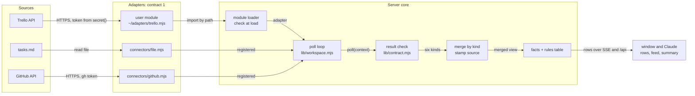

# Integration contract: one way for any source to reach the dashboard

Frozen plan, 2026-11-03. Linear RMA-95. Code references are to `main` at `dabc8ce` unless a line says
"PoC", which means the proof of concept on branch `rma-95-integration-contract`. The decisions this plan
proposes are recorded in [ADR 0008](../adr/0008-integration-contract.md); the contract as built is the
mechanism page [`connector-contract`](../mechanisms/connector-contract.md).

The one-line answer: the contract already exists, implicitly, and it is a good one. A connector is an ESM
module with a few named exports whose `poll` returns normalised lists of six kinds. The work is to make it
explicit and versioned, let a module declare which kinds it supplies, let a user name their own module by
path, and check it. A plugin platform, a second transport or a generic data model is not needed for the
alpha and is not built; the plan leaves room for each of them and says what would trigger it.

## 1. Audit: the connectors and what depends on them

### 1.1 The contract as the code exercises it today

| Export | github | jira | linear | demo | Read by |
|---|---|---|---|---|---|
| `id`, `label` | yes | yes | yes | yes | `connectors/index.mjs:12`, `:15` (catalogue, summaries) |
| `fields` | 6, no secret | 5, one secret | 5, one secret | 2 | `connectors/index.mjs:15`, `:18`, `:31`; `lib/config.mjs:174` (boolean check) |
| `links(settings)` | yes | yes | yes | yes | `lib/workspace.mjs:175` |
| `endpointKey` | no | `base` | no | no | `connectors/index.mjs:20` (secret binding) |
| `persistedCache` | `prs, asks, runStreaks` | no | no | no | `lib/workspace.mjs:120` |
| `poll(context)` | `settings, http, cache, sinceIso, keyOf` | `settings, http, secrets, cache` | `settings, http, secrets, cache` | `settings, cache` | `lib/workspace.mjs:110` |

`poll` resolves to `{ me, ticket_base?, errors, tickets?, comments?, prs?, activity?, asks?, runs? }`.
The workspace stamps every item with the entry id as `source` (`lib/workspace.mjs:13-19`), merges the six
kinds across entries (`:35`), and evaluates rows and the feed over the merged view (`:42-51`). A thrown
error becomes the entry's error, `RateLimited` doubles the poll delay (`:113-115`, `lib/backoff.mjs:2`);
a part that fails inside a poll is reported in `errors` and prefixed with the entry id (`:111`). Nothing
checks the shape of what a connector returns.

Partial capability support already exists, unnamed: jira and linear return only `tickets` and
`comments` (`connectors/jira.mjs:154`, `connectors/linear.mjs:112`), github only `prs`, `asks`, `runs`,
`activity` (`connectors/github.mjs:315`), and demo either side by `part` (`connectors/demo.mjs:139-145`).
The rules treat a missing kind as an empty list (`lib/rules.mjs:147`, `:179`).

### 1.2 Who knows a source type by name

Measured with `git grep -i -w -E "github|jira|linear|gh"` over `lib/`, `web/src/` and `server.mjs`,
tests excluded, and excluding the feedback feature (`lib/feedback.mjs`, `lib/linear-api.mjs`, which file
issues to the maintainer's Linear and are not a connector) and three false hits (`linear-gradient`, the
"linear" colour space and the word "linear" in a comment):

| File | Lines | What they are | Kind of leak |
|---|---|---|---|
| `lib/facts.mjs` | 13 | `from:` descriptions in `FACTS` (`:12-34`) | documentation only; the facts are computed from shapes |
| `lib/config.mjs` | 9 | the flat pre-workspace config (`:105-114`, `:279-280`), two hints (`:36-37`) | legacy migration, wording |
| `web/src/features/feed/FeedItem.vue` | 2 | icon tone `source.type === 'github' ? '' : 'jira'` (`:23`, `:121`) | **the window branches on a type** |
| `web/src/lib/feed.ts` | 2 | the "GH" badge for a GitHub connector (`:80-82`) | **the window branches on a type** |
| `web/src/features/first-run/FirstRun.vue` | 1 | "add my GitHub repository" (`:33`) | wording |

`CONNECTORS[entry.type]` is read at 8 places, all in the registry (`connectors/index.mjs`, 4), the
config (`lib/config.mjs:174`) and the workspace (`lib/workspace.mjs:104`, `:120`, `:175`). No rule, no API
route and no window component imports a connector. Of 27 lines that name a source type, 4 are behaviour
and they sit in two window files; the rest is documentation, wording and the legacy config.

### 1.3 Where source-specific knowledge leaks into the shapes

Type names are the small problem. The larger one is that the normalised shapes carry the vocabulary of
the first two sources:

- `status_category` takes Jira's status-category keys `new`, `indeterminate`, `done`
  (`connectors/jira.mjs:133`); Linear translates into them (`connectors/linear.mjs:34`); the facts read
  them (`lib/facts.mjs:6`, `:121-122`).
- A PR's `state` is `OPEN`/`CLOSED`/`MERGED`, `review` is GitHub's `APPROVED`/`CHANGES_REQUESTED`
  (`connectors/github.mjs:57-69`, `:83`); the facts lower-case them (`lib/facts.mjs:81-88`), the header
  tile counts `pr_state === 'OPEN' && checks === 'failing'` (`lib/rules.mjs:219`), the window shows the
  state (`web/src/ui/PrCell.vue:14-19`) and the hand-off prints it (`lib/handoff.mjs:57`).
- An ask's `kind` is one of two GitHub notification reasons; `askRow` builds its texts from
  `kind === 'review requested'` (`lib/rules.mjs:128-136`).
- The run kind's `ref` is `<repo>:<workflow>@<branch>` (`connectors/github.mjs:169`), a CI notion.
- Secrets: jira and linear declare a secret field bound to an account field and read the store
  themselves (`connectors/jira.mjs:107-114`, `connectors/linear.mjs:63-70`); github reads `gh auth token`
  and has no secret field at all (`connectors/github.mjs:26-32`). The binding that stops a local process
  from redirecting a stored token (`connectors/index.mjs:18-27`) only knows declared secret fields and the
  one `endpointKey`.

None of this is wrong for the six kinds as they are: the vocabularies are closed, documented in
`FACTS` and small. It means the kinds are "work-tracker and code-review shaped", and a source of a
different nature has to map onto them. That is the main input to the decision in section 4.4.

### 1.4 What the consumers need

Four core modules read the kinds: the workspace merge (`lib/workspace.mjs:35`), the rules and the feed
(`lib/rules.mjs:147-203`), the facts (`lib/facts.mjs:103-128`) and the hand-off (`lib/handoff.mjs:9-10`).
The window never sees a kind; it sees rows (`web/src/lib/types.ts:33-60`) and feed items (`:62-75`)
that the server built. The API exposes the merged kinds only in the full snapshot
(`lib/workspace.mjs:211`). So the dependency is one-directional and narrow: sources → six shapes →
four modules → rows → window. A new source that fills the six shapes touches nothing downstream.

## 2. Survey: how comparable systems do it

| System | How a source plugs in | Boundary | Lesson for us |
|---|---|---|---|
| Ports and Adapters (Cockburn) | the core owns a port, an adapter implements it per technology | none, a design rule | we already have the port: `poll` plus the six shapes |
| Backstage entity providers ([docs](https://backstage.io/docs/features/software-catalog/external-integrations/entity-providers)) | a class with `getProviderName()` and `connect(connection)`; it pushes `applyMutation` of type `full` (replace the bucket) or `delta` (added, removed); registered in a backend module | in-process TypeScript | full replace per provider is what our per-entry `state.sources[id]` does; delta is an optimisation we do not need |
| Home Assistant integrations ([manifest](https://contributors.home-assistant.io/core/integrations/manifest/)) | a folder with a manifest: `domain`, `config_flow`, `iot_class` (`local_polling`, `cloud_push`…), pinned `requirements`; `version` required for custom integrations | in-process Python, custom integrations run with core's rights | a declared manifest and a version on user code; a UI config flow per integration |
| Grafana backend plugins ([docs](https://grafana.com/developers/plugin-tools/key-concepts/backend-plugins/)) | a subprocess over gRPC (HashiCorp go-plugin) with capabilities: query data, resources, health check, metrics, streaming | separate process; "a panic in a plugin doesn't crash the Grafana server" | capabilities as named, optional services; a health check is a capability |
| VS Code extension host ([docs](https://code.visualstudio.com/api/advanced-topics/extension-host)) | extensions run in an extension host, activated lazily by declared events | a separate host for responsiveness, not a sandbox: extensions reach the workspace | process separation buys stability, not security |
| Singer taps ([spec](https://hub.meltano.com/singer/spec/)) | any executable that reads `config.json` and `state.json` and writes `SCHEMA`, `RECORD`, `STATE` lines to stdout | separate process, any language | incremental sync as an opaque state the host stores and hands back |
| Airbyte protocol ([docs](https://docs.airbyte.com/platform/understanding-airbyte/airbyte-protocol)) | an actor with `spec`, `check`, `discover`, `read`; state is an opaque blob only the source interprets | containers | `spec`/`check` map to our `fields` and a health check; state stays the adapter's |
| Airbyte low-code ([docs](https://docs.airbyte.com/platform/connector-development/config-based/low-code-cdk-overview)) | a YAML manifest: requester, record selector, paginator (offset, page, cursor, link header) | interpreted by the platform | the declarative long tail is real, and it is a framework of its own |
| Claude Code plugins ([docs](https://code.claude.com/docs/en/plugin-marketplaces)) | a marketplace entry with a `source`: relative path, `github`, `git-subdir`, `url`, `archive`, `npm`, `command`; `claude plugin validate` checks it | the plugin runs with the user's rights | a path or a package is enough for discovery; a validate command is part of the developer experience |
| MCP ([transports](https://modelcontextprotocol.io/specification/2025-06-18/basic/transports), [tools](https://modelcontextprotocol.io/specification/2025-06-18/server/tools)) | a server over stdio (the client launches a subprocess, newline-delimited JSON-RPC) or Streamable HTTP; tools may declare an `outputSchema`, results carry `structuredContent` that "clients SHOULD validate" | separate process | a ready-made, well-known framing for an out-of-process adapter; tools are "model-controlled", not a polling contract |

Node's own permission model is not an isolation option for an in-process module: it applies to the whole
process and "does not protect against malicious code" ([Node docs](https://nodejs.org/api/permissions.html)).

Common shape across all of them: a declared identity and version, a configuration schema, a check
operation, one read operation, opaque state the host keeps, and errors that name the part that failed.
None of them gives in-process user code real isolation; those that isolate do it with a process.

## 3. Alternatives compared

| | A. In-process ESM module by path | B. External process, stdio JSON-RPC (MCP-shaped or own) | C. HTTP endpoint the user runs | D. Declarative source (URL + JSONPath/JQ mapping) |
|---|---|---|---|---|
| What the user writes | one `.mjs` file with five exports | a program in any language | a service in any language | a JSON block in the config |
| Core cost now | small: load, check, same poll path (PoC: `connectors/module.mjs`, 70 lines) | a supervisor: spawn, framing, timeouts, restart, stderr capture, ~300 lines | an HTTP client call per poll, auth to the endpoint | a mapping language and its interpreter: pagination, auth, transforms |
| Runs with | the server's rights: every token in memory, the secret store, the file system, the network | the user's OS rights; receives only its own settings and token | whatever the user gave the service | the server's HTTP client; no user code |
| Trust boundary | none inside the user; the boundary is "the user chose this file" | process: a crash or a hang does not stop the poll loop; other tokens are not in its memory | network: none on localhost beyond what the endpoint checks | the mapping is data; the risk is SSRF and token forwarding, as for built-ins |
| Failure isolation | a throw is the entry's error; a hang or a busy loop blocks the server | full | full | full |
| Languages | JavaScript | any | any | none |
| AI-agent fit | best: one file, typed by `types/connector.d.ts`, checked by one command | good with MCP SDKs, worse with our own protocol | fair | poor for anything with auth or pagination |
| Fits "no runtime npm dependencies" | yes | yes, hand-written framing | yes | only with a hand-written JSONPath subset |

**Choice: A now, B when a real need appears, D never as a framework.**

- A is what the built-ins already are, so one mechanism serves official and user adapters from the start
  (brief item 5). It costs a loader and a checker, both built in the PoC.
- A gives no isolation, and that is acceptable for this tool's trust model: the user names the file, the
  server runs as the user, and the config API already trusts every local process (AGENTS.md, decisions
  in force). The adapter can do nothing that the user's own shell cannot. What A must not do is make it
  easier for someone else's code to run: section 6.
- B is the answer to three triggers, none of them present: an adapter in another language, an adapter
  the user does not fully trust (downloaded, not written), or an adapter that hangs. Its wire format
  should then be MCP stdio with one tool, `poll`, whose `outputSchema` is the contract's JSON schema: an
  agent knows MCP, SDKs exist in every language, and the framing is newline-delimited JSON-RPC that Node
  reads without a dependency. The adapter side stays the same five exports translated to `tools/list`
  plus `tools/call`.
- C is B over a socket with an auth problem added; it is the right shape only for a team service, and
  then the team writes an A adapter that calls it.
- D would reinvent Airbyte's low-code CDK. The long tail it targets (a JSON URL with a token) is a
  twenty-line A adapter that an agent writes from the template in minutes, with real code for pagination
  and auth instead of a mapping language. A `file` connector (PoC) covers local data without any mapping.

## 4. The proposed contract

### 4.1 One contract, capabilities declared

One contract, version `1`, with the six kinds as capabilities. An adapter exports:

```js
export const contract = 1;
export const id = 'trello';                 // lowercase, digits, hyphens
export const label = 'Trello';
export const capabilities = ['tickets', 'comments'];
export const fields = [{ key: 'board', label: 'Board id', required: true }];
export const poll = async ({ settings, http, cache, sinceIso, historyDays, keyOf, secret }) => ({ me, tickets, comments, errors });
```

Several contracts (a "task source", a "code-review source", a "CI source") were considered and
rejected: the kinds join on `key` (a PR's ticket, a comment's ticket), demo and github each supply kinds
that would sit in two contracts, and the rules read the merged view, so the split would be in the
declarations only. Capabilities give the same partial support with one loader, one checker and one doc.

The shapes are those the core consumes today, written down in `lib/contract.mjs` (PoC, `SHAPES`) and
`types/connector.d.ts` (PoC). They are closed per contract version: a field's type and its closed values
(`status_category`, `state`, `review`, `checks`, an ask's `kind`) are part of the version.

### 4.2 Data handover and normalisation

- The adapter normalises; the core never sees a source's raw payload. That is the rule today
  (AGENTS.md, "Connectors") and the one place where per-source knowledge belongs.
- Only declared kinds may be returned; an undeclared kind is a contract error, not silently dropped
  (PoC `lib/contract.mjs` `resultProblems`). A declared kind that is missing is an empty list.
- Every link is empty or `https://` (the hard rule on untrusted data), checked at the boundary rather
  than only in the window (`web/src/lib/api.ts:48-50`).
- Text stays text: bodies are rendered as text by the window and framed as untrusted in hand-offs
  (`lib/handoff.mjs:113`). The contract adds nothing here and removes nothing.
- `me` is the user's name in the source as it appears in `assignee`, `author` and `@` mentions; the
  rules compare by equality (`lib/rules.mjs:62-73`, `lib/facts.mjs:120`).

### 4.3 Filtering, pagination, refresh, incremental polling, errors

- **Filtering** is the adapter's own settings (`jql`, `team`, `board`), declared in `fields`. The core
  passes `sinceIso` and `historyDays` for the feed window; nothing else is a core-level filter. A shared
  filter language would push the core into every source's query model for no gain.
- **Pagination** is internal to `poll`: Linear loops over `pageInfo` (`connectors/linear.mjs:72-86`),
  Jira over changelog pages (`connectors/jira.mjs:86-102`). The contract asks for the complete current
  set; a full replace per entry (`lib/workspace.mjs:134`) is the Backstage "full mutation" model and is
  right for sets this size (hundreds of items).
- **Refresh** is the server's loop (`server.mjs:44-50`) at `poll_seconds`, with backoff on
  `RateLimited`. An adapter that wants a slower cadence keeps its own timestamp in `cache` and returns
  the previous result. Push (webhooks) is out of scope: the monitor runs on a laptop behind NAT.
- **Incremental polling** is the adapter's business, with two helpers: `http.fetchJson` keeps ETags and
  serves 304 from memory (`lib/http-client.mjs:14-41`), and `cache` survives between polls. Cursors are
  opaque to the core, as in Singer and Airbyte. Contract 1 does not persist a user adapter's cache;
  contract 1.1 adds `persistedCache` for adapters (section 6.3), the mechanism github already uses.
- **Errors**: throw for a total failure (the entry shows the message and the health check counts the
  failure, `lib/workspace.mjs:150`); return `errors: { part: message }` for a partial one (github's
  pulls/notifications/runs, `connectors/github.mjs:297-305`); throw `RateLimited` (exported from
  `lib/http-client.mjs`) to back off. A contract violation is a `ContractError` whose message lists each
  problem (PoC). An adapter's message is shown to the user, so it names the thing to fix and holds no
  token.

### 4.4 How a new kind of data reaches the rules

The rules table reads a closed fact dictionary (`lib/facts.mjs:10-35`) validated on load
(`lib/table.mjs:77`). Facts are computed from kinds, never by adapters (`docs/mechanisms/rules-table.md`,
"Facts"). Three ways to let a calendar, a mailbox or a custom source into the rules:

1. **Map onto the existing kinds.** A calendar event that needs an answer is an `ask`; a to-do in a
   file is a `ticket` (PoC `connectors/file.mjs`); a message that asks you something is an `ask` or a
   `comment` on a `ticket`. Zero core change. Limit: the row texts are written for tickets and reviews.
2. **A new core kind**, the way `runs` arrived in RMA-152: a shape in `SHAPES`, a facts function
   (`runFacts`, `lib/facts.mjs:103-109`), default rows, and a contract minor version. One PR in the core
   per kind, each kind designed once for every source that has it.
3. **A generic kind with adapter-declared facts**: `items` with a `facts` object whose names the adapter
   declares (`facts: { 'event.starts_in_hours': { type: 'number' } }`), merged into `FACTS` under a
   namespace per entry, so a workspace table can test them and the default table never does.

Recommended: 1 now, 2 when two sources want the same new kind, 3 only if a user brings a source that
fits neither. 3 is the most flexible and the most expensive: it turns the closed dictionary into an open
one, the settings sheet and Claude must learn per-entry facts, and a table written against one adapter
breaks when the adapter changes.

### 4.5 Configuration and secrets stay in the contract

- `fields` is the settings-sheet catalogue (`connectors/index.mjs:15`, `lib/api.mjs:150`); a user adapter
  declares its fields the same way. Contract 1 in the PoC shows a `module` entry's own fields (path,
  token), not the adapter's; showing the adapter's fields needs an async catalogue and is stage 3.
- A user adapter never sees the secret store. It gets one function, `secret()`, that returns the token
  stored for its entry (PoC `connectors/module.mjs:63-64`). The token is filed under the service
  `whose-turn-adapter` and the adapter **path** as the account, and the path is the entry's endpoint
  (`endpointKey: 'path'`), so the existing binding (`connectors/index.mjs:18-27`) refuses a config write
  that points a stored token at another file unless the token is entered again (PoC test
  `test/module-connector.test.mjs`). Several secrets per adapter are stage 3.

## 5. Interaction scheme



In the PoC the result check runs for user modules only (`connectors/module.mjs`, `pollAdapter`); the
built-ins reach the merge unchecked, as today. Stage 1 puts every connector through it.

## 6. Security, lifecycle, versioning

### 6.1 Trust model

- **Built-in connectors** are the package's code, reviewed in this repository.
- **A user module is the user's code.** It runs inside the server with every right the server has: the
  tokens in memory, the secret store (`security`, `secret-tool`), the file system, the network. The
  server does not pretend otherwise; the mechanism page says so in its first paragraph, and the settings
  sheet will say "runs your code from <path>" on the entry (stage 3).
- What the server does guard is that **nobody but the user picks the file**. Today any local process can
  write the config through the API (accepted in AGENTS.md); a local process can also run code as the user
  directly, so a module entry adds no new reach for it. A browser cannot write the config (Host and
  Origin checks), so a web page cannot plant a module. Stage 2 adds two cheap guards: the path must be
  absolute or `~`-relative and resolve outside the data directory and outside any directory a source
  writes into, and a module entry added through the API is inactive until the user confirms it in the
  window once (a trust record keyed by path and content hash, re-asked when the file changes).
- **Out-of-process (B)** is the answer for code the user did not write: it limits what the adapter
  receives (only its settings and its token), not what it can do as the same OS user. Real confinement
  needs an OS sandbox and is out of scope for a local monitor.

### 6.2 Lifecycle

| Step | Today | Contract 1 (PoC and stage 2) |
|---|---|---|
| Register | a type in `CONNECTORS` (`connectors/index.mjs:7`) | built-ins the same; a user adapter by `{ "type": "module", "path": … }` in a workspace |
| Configure | settings sheet or `POST /api/config` | the same; the adapter's `fields` in the entry |
| Validate | config shape only (`lib/config.mjs:147-181`) | the module is imported and checked at its first poll, a `ContractError` names each problem; stage 2 checks on save so the save is refused |
| Poll | `lib/workspace.mjs:103-117` | the same path; the result is checked before the merge |
| Pause | not possible except by removing the entry | stage 2: `"enabled": false` on any entry |
| Change | the registry rebuilds a workspace whose definition changed (`lib/registry.mjs:13-29`) | the loader re-imports a module whose file changed (mtime), PoC `connectors/module.mjs:24-40` |
| Remove | the entry's state is dropped at the next poll (`lib/workspace.mjs:137-141`) | the same; a stored token stays in the secret store until removed by hand |

The PoC loads a module at its first poll, not at config load, because the registry builds workspaces
synchronously (`lib/registry.mjs:20`) and `import()` is asynchronous. The cost is that a broken module
shows up as the entry's error after one poll interval rather than as a refused save. Re-importing on
change keeps the old module instance in memory (ESM has no unload); harmless at the scale of a user
editing a file, and a reason to move to B if adapters are reloaded often.

### 6.3 Versioning and compatibility

- `contract` is an integer the adapter exports. The server speaks a set of versions; today `{1}`.
- **Minor, additive changes keep the number** and are listed on the mechanism page with the date: a new
  optional field, a new kind, a new context helper, `persistedCache` for adapters. An adapter written
  for 1 keeps working.
- **A breaking change bumps the number**: a renamed field, a new required field, a changed closed value.
  The server then speaks both versions for at least one release, adapting the old shape in the loader,
  and the error for an unsupported version names both numbers ("contract 3 is not supported; this server
  speaks contract 1", PoC `lib/contract.mjs:87`).
- Built-ins move in the same release as the contract; they are the first adapters checked against it.
- The window never sees the contract version; rows are the window's contract and keep their own types
  (`web/src/lib/types.ts`).

## 7. Developer experience for people and agents

The target scenario: the user says "I want my Trello cards on the dashboard"; the agent reads one page,
copies a template, implements `poll`, runs one command until it passes, adds one config entry, and the
cards appear as rows. No core change.

- **One page as the single source**: `docs/mechanisms/connector-contract.md` (PoC). The exports, the
  context, the six shapes with their closed values, errors, versioning, the trust note, the template and
  the check. Declared as a mechanism, so a change to the contract cannot land without a change to the
  page (`scripts/docs-check.py`, paired docs).
- **Types**: `types/connector.d.ts` (PoC), shipped in the package (`package.json` `files`). An adapter
  in plain `.mjs` gets checking with one JSDoc line, `/** @type {import('whose-turn/types/connector.js').Adapter['poll']} */`;
  the fixture `test/fixtures/adapters/board.mjs` type-checks strictly against it.
- **Template and examples**: the simple example is the page's template (a JSON endpoint with a token);
  the complex ones are the built-ins themselves, github for partial errors and caches, linear for
  pagination, file for a source with no network.
- **Conformance check**: `node scripts/check-adapter.mjs <file> --settings '{…}'` (PoC) checks the
  exports, runs one poll, checks the result and prints the rows the default rules make of it, so the
  agent sees "BRD-1 · Continue the work" rather than "valid". Exit 0 passes, 1 is a contract problem with
  one line per problem, 2 is a usage error. Stage 2 ships it as `npx whose-turn check-adapter`, with
  fixtures: recorded responses the adapter can be run against offline.
- **Clear incompatibility errors**: every problem names the export or the item and field
  (`tickets[0].status_category is missing`, `capability "emails" is unknown; contract 1 knows tickets,
  comments, prs, activity, asks, runs`).
- **A Claude skill step** in the BladeForge `whose-turn` skill: "add a source" reads the page, writes the
  adapter under `~/.config/whose-turn/adapters/` or the user's chosen place, runs the check, and posts
  the entry through `POST /api/config`. That lives in BladeForge and follows stage 2.

## 8. Adoption plan, lowest risk to the alpha first

Nothing in this plan changes a row, a feed item or a request of the four existing connectors before
stage 1, and stage 1 changes only what they export.

- **Stage 0, this branch (PoC).** `lib/contract.mjs`, `types/connector.d.ts`, the `file` and `module`
  connectors registered as experimental (accepted in the config, not offered by the settings catalogue),
  `scripts/check-adapter.mjs`, the mechanism page, ADR 0008 proposed. The four built-ins are untouched;
  the workspace imports `KINDS` from the contract instead of defining it.
- **Stage 1, built-ins on the contract.** Each built-in exports `contract` and `capabilities` (the check
  says this is all they lack: `check-adapter connectors/github.mjs` reports exactly those two lines);
  every poll result goes through `resultProblems` in `pollSource`, in report-only mode first (a problem
  is logged as the entry's partial error, the data still flows) for one week of the maintainer's real
  workspaces, then enforcing. The two window branches on a type (`FeedItem.vue:23`, `feed.ts:82`) move
  to a `glyph` and a `tone` the catalogue sends.
- **Stage 2, user adapters supported.** Module checked on save, `enabled: false`, the path guards and
  the trust confirmation of 6.1, `npx whose-turn check-adapter` with offline fixtures, `persistedCache`
  for adapters, the template on the page, the Claude skill step in BladeForge.
- **Stage 3, settings for user adapters.** The catalogue lists a module's own fields after loading it,
  several secrets per adapter, "runs your code" on the entry, `file` and `module` offered in the sheet.
- **Stage 4, only on a trigger** (a non-JavaScript adapter, an untrusted adapter, a hanging one): the
  out-of-process transport, MCP stdio with a `poll` tool, the same check run against it.
- **Stage 5, only on a trigger** (two sources want the same new kind, or one fits no kind): a new core
  kind (4.4 option 2), or adapter-declared facts (option 3) with its own ADR.

## 9. Stages and readiness criteria

| Stage | Ready when |
|---|---|
| 0 | `npm run check` and `python3 scripts/docs-check.py` green; a Markdown file and a fixture module produce rows through `workspace.poll()` in node:test; `check-adapter` passes the fixture and fails a broken one with one line per problem; the four built-ins byte-identical to `main` |
| 1 | each built-in passes `check-adapter` with `--no-poll`; one week of report-only checks on the maintainer's workspaces shows no problem, or each found is fixed in the connector; "your move" rows on 8766 equal those before the change; no `type ===` in `web/src` |
| 2 | an agent given only the mechanism page writes a working adapter for a public JSON API in one session, verified by a recorded run; a broken module is refused on save with the same messages; an API-added module stays inactive until confirmed in the window |
| 3 | a user adds, configures and removes a module adapter from the settings sheet alone, token included |
| 4 | a stdio adapter in a second language passes the same check; a hanging adapter times out without delaying other entries |
| 5 | a new kind ships with its shape, facts, default rows, a contract minor version and a page entry |

## What this plan does not decide

- A registry or marketplace of adapters. A path is enough until several people share adapters; then a
  `source` like Claude Code's (`github`, `npm`) can be added to a module entry.
- Writing back to sources (closing a ticket from the window). The contract is read-only; a write
  capability would be a new, separate decision.
- Moving the feedback feature (`lib/feedback.mjs`) onto the contract. It writes, not reads.
